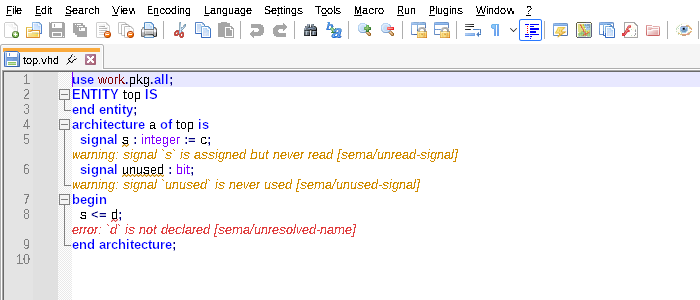
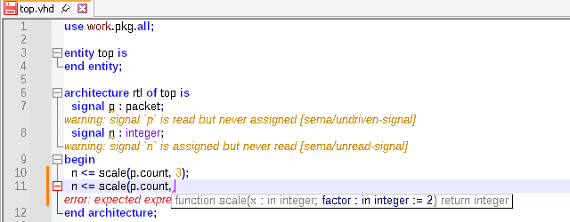

# vfl for Notepad++

A Notepad++ plugin that formats and lints VHDL with vfl, as you type, and brings the
features of the vfl language server to Notepad++: types, parameter hints, completion,
quick fixes, go to definition, find references, rename and symbol search.



The formatter and linter are built into the plugin, so there is nothing else to install: no
`vfl` executable on the `PATH` and no LSP client plugin. The plugin finds the project around
each file like `vfl lint` does, so names resolve across files, and it reads the same
`vfl.toml` settings.

## Features

- **Lint as you type**: problems are underlined and their messages shown under the line,
  a moment after you stop typing, and when a VHDL file is opened, switched to or saved.
  Unsaved edits in the file count; other files are read from disk, and files changed
  outside Notepad++ are picked up when you come back to it. Unused names are greyed out.
- **Names colored by meaning**: signals, ports, constants (and generics and enumeration
  literals), variables (and parameters), types and subprograms each get a color, from what
  the analysis resolved them to, refreshed along with the problems. The colors follow a
  light or dark theme.
- **Hover** over a name to see what it is, its type and its declaration, and over an
  underline to see the problem.
- **Parameter hints**: typing `(` or `,` in a subprogram call, port map or generic map
  shows the signature, with the parameter being typed highlighted. Overloads are listed
  one per line. The hint follows the caret and closes when it leaves the call.
- **Completion** after a dot: the elements of a record, the methods of a protected type,
  the units of a library, the declarations of a package. Elsewhere, **Complete word** lists
  what is visible at the caret and the VHDL keywords. An icon shows what each item is, and
  the status bar says more about the selected one.


- **Format document**, as one undo step that keeps the caret and scroll position.
  Optionally on every save.
- **Next problem** / **Previous problem** jump between problems.
- **Quick fixes**: **Fix problem at caret** lists the fixes for the problem at the caret,
  **Fix all problems** applies every safe fix in the file.
- **Go to definition**, also into the bundled `ieee` and `std` sources, and **Go back**.
- **Find references** lists every use of a name across the project; choosing one opens it.
  **Highlight uses** marks the uses of the name at the caret in the file, reads and writes in
  two colors.
- **Rename symbol** renames a name everywhere it is used, in every file of the project, as
  one undo step per file. Renaming in files other than the current one asks first.
- **Go to symbol in file** lists the file's declarations, nested; **Go to symbol in project**
  searches the declarations of the whole project.
- **Code generation**: insert an entity or component instantiation or a component
  declaration at the caret, or generate a testbench next to the entity.

## Commands

All under **Plugins > vfl**. To give them keyboard shortcuts, use **Settings > Shortcut
Mapper > Plugin commands**.

| Command | |
|---|---|
| Format document | Formats the current file with its `vfl.toml` settings. Files with syntax errors are not formatted; the caret goes to the first error. |
| Lint document | Lints the current file, whatever its language, and goes to the first problem. |
| Next problem, Previous problem | Moves to the next or previous problem and shows its message. |
| Fix problem at caret | Lists the fixes for the problems at the caret; a single safe fix is applied directly. |
| Fix all problems | Applies every fix that can be applied safely to the current file, as one undo step. |
| Clear problems | Removes the underlines and messages from the current file. |
| Go to definition | Opens the declaration of the name at the caret. Library units such as `ieee.std_logic_1164` open as read-only copies of the bundled sources. |
| Go back | Returns to where Go to definition, Find references or a symbol list jumped from. |
| Find references | Lists every use of the name at the caret, in the whole project. |
| Rename symbol | Asks for a new name and renames the name at the caret everywhere. Files that change on disk since they were analyzed are skipped. |
| Go to symbol in file | Lists the declarations of the current file. |
| Go to symbol in project | Searches the declarations of the project by name, starting from the word at the caret. |
| Insert entity instantiation, Insert component instantiation, Insert component declaration | Lists the entities of the project, those of the current file first, and inserts the code for the one picked at the caret. |
| Generate testbench | Lists the entities of the project and writes a testbench for the one picked next to it (`<entity>_tb.vhd`, see `[generate]` in `vfl.toml`), then opens it. |
| Show type | Shows what the name at the caret is, as hovering it does. |
| Show parameters | Shows the parameter hints of the call around the caret. |
| Complete word | Lists the completions at the caret. Notepad++ keeps **Ctrl+Space** for its own completion, so map this to another key if you use it often. |
| Format on save | Formats VHDL files when they are saved (off by default). With **Save All**, only the file in front is formatted. |
| Lint automatically | Lints VHDL files as described above (on by default). |
| Show messages under lines | Shows each message under its line (on by default); with it off, hover or use Next problem. |
| Code assistance | Types on hover, parameter hints and completion after a dot (on by default). The three commands above work either way. |
| Highlight uses | Highlights the uses of the name at the caret (on by default). |
| Color names by meaning | Colors signals, ports, constants, variables, types and subprograms (on by default). |
| Reload project | Re-reads the whole project from disk. Changed files are normally picked up by themselves, so this is rarely needed. |

The five settings are kept in `plugins\Config\vfl_npp.ini`. Problems in `vfl.toml` are
shown in a message box, once per problem.

A file is VHDL when Notepad++ shows it as VHDL, or its extension is `.vhd`, `.vhdl`, `.vho`
or `.vht`.

## Install

Tested with Notepad++ 8.8.6, 64-bit.

1. Get `vfl_npp.dll`: from the `vfl_npp` artifact of a CI run, or build it (below).
2. Close Notepad++ and create the folder `plugins\vfl_npp` in its install directory
   (usually `C:\Program Files\Notepad++\plugins\vfl_npp`).
3. Put `vfl_npp.dll` in it and start Notepad++. **Plugins > vfl** appears.

## Build

On Windows, with Rust installed:

```sh
cargo build --release -p vfl-npp
```

The plugin is `target\release\vfl_npp.dll`. For 32-bit or ARM64 Notepad++, add
`--target i686-pc-windows-msvc` or `--target aarch64-pc-windows-msvc`.

From Linux, with `mingw-w64` installed:

```sh
rustup target add x86_64-pc-windows-gnu
cargo build --release -p vfl-npp --target x86_64-pc-windows-gnu
```

## How it works

Notepad++ has no built-in language-server support, so rather than going through a
third-party LSP client this is a native plugin. It is written in Rust and links the vfl
crates directly:

- `src/engine.rs` formats, lints and answers the editor queries for a buffer: hover,
  parameters, completion, definitions, references, rename, symbols and fixes. It keeps each project it has seen loaded, as the language server does, with the
  buffer's unsaved text in place of the file on disk, and re-analyzes only the design units
  an edit can affect. The answers come from the language server's own code, through
  `vfl_lsp::editor`, so they match what VS Code shows. It is portable and unit-tested on
  every platform.
- `src/plugin.rs` is the Notepad++ side: the exported plugin functions, the menu, showing
  problems with Scintilla indicators, annotations and call tips, and showing types,
  parameter hints and completion lists.
- `src/tools.rs` is the navigation and refactoring side: lists of locations, symbols and
  fixes, jumps and the way back, rename across open files, and highlighting uses.
- `src/win.rs` declares the few Win32, Scintilla and Notepad++ definitions it uses.

Messages under lines use Scintilla annotations, which other plugins may also use; the plugin
replaces the annotations of a VHDL file each time it lints it. Turn **Show messages under
lines** off if that conflicts with another plugin.
