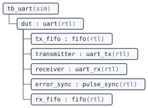

# UART example

5 entities and 1 packages in 1 library.

## Design hierarchy

## Entities

| Entity | Library | Description |
|---|---|---|
| [`fifo`](work.fifo.md) | `work` | A synchronous first-in first-out buffer. |
| [`tb_uart`](work.tb_uart.md) | `work` | Sends a byte through the UART looped back on itself. |
| [`uart`](work.uart.md) | `work` | A UART with a FIFO on each side. |
| [`uart_rx`](work.uart_rx.md) | `work` | Deserializes frames of eight data bits and one stop bit, sampling each bit in its middle. |
| [`uart_tx`](work.uart_tx.md) | `work` | Serializes bytes: a start bit, the data bits LSB first, an optional parity bit and a stop bit. |

## Packages

| Package | Library | Description |
|---|---|---|
| [`uart_pkg`](work.uart_pkg.md) | `work` | Shared definitions of the UART. |
