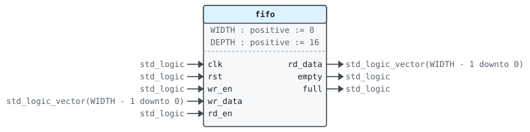
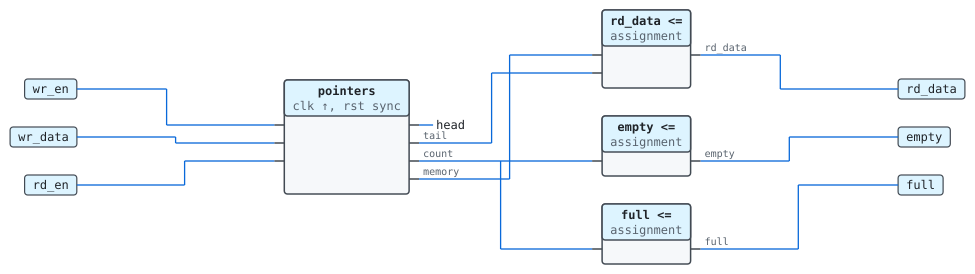

# Entity `fifo`

Library `work` · `rtl/fifo.vhd:8`

Uses `ieee.std_logic_1164`, `ieee.numeric_std`.

A synchronous first-in first-out buffer.

Writes to a full FIFO and reads from an empty one are ignored.

## Generics

| Name | Type | Default | Description |
|---|---|---|---|
| `WIDTH` | `positive` | `8` | Bits per word |
| `DEPTH` | `positive` | `16` | Number of words |

## Ports

| Name | Direction | Type | Description |
|---|---|---|---|
| `clk` | in | `std_logic` | Clock |
| `rst` | in | `std_logic` | Synchronous reset, active high |
| `wr_en` | in | `std_logic` | Write `wr_data` this cycle |
| `wr_data` | in | `std_logic_vector(WIDTH - 1 downto 0)` | Word to write |
| `rd_en` | in | `std_logic` | Take the oldest word |
| `rd_data` | out | `std_logic_vector(WIDTH - 1 downto 0)` | Oldest word |
| `empty` | out | `std_logic` | No word to read |
| `full` | out | `std_logic` | No room to write |

## Instantiated by

- [`uart(rtl)`](work.uart.md#arch-rtl) as `tx_fifo`
- [`uart(rtl)`](work.uart.md#arch-rtl) as `rx_fifo`

## Architecture `rtl`

### Data flow

### Processes

| Process | Sensitivity | Clock | Drives | Description |
|---|---|---|---|---|
| `pointers` | `clk` | `clk` | `head`, `tail`, `count`, `memory` | Moves the pointers and stores written words. |

### Signals

| Name | Type | Default | Description |
|---|---|---|---|
| `memory` | `memory_t` |  |  |
| `head` | `natural range 0 to DEPTH - 1` | `0` | Next word to write |
| `tail` | `natural range 0 to DEPTH - 1` | `0` | Next word to read |
| `count` | `natural range 0 to DEPTH` | `0` | Words stored |

### Types

| Name | Kind | Definition |
|---|---|---|
| `memory_t` | type | `array (0 to DEPTH - 1) of std_logic_vector(WIDTH - 1 downto 0)` |
