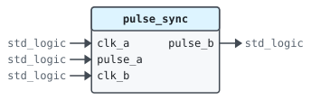
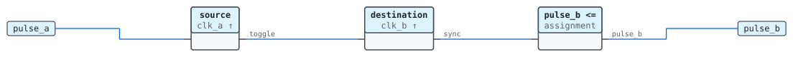
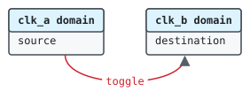
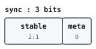

# Entity `pulse_sync`

Library `work` · `rtl/pulse_sync.vhd:8`

Uses `ieee.std_logic_1164`.

Carries single-cycle pulses from one clock domain to another.

Each source pulse flips a toggle; the destination domain synchronizes the
toggle through two flip-flops and pulses when it changes.

## Ports

| Name | Direction | Type | Description |
|---|---|---|---|
| `clk_a` | in | `std_logic` | Source clock |
| `pulse_a` | in | `std_logic` | Pulse in the source domain |
| `clk_b` | in | `std_logic` | Destination clock |
| `pulse_b` | out | `std_logic` | Pulse in the destination domain |

## Instantiated by

- [`uart(rtl)`](work.uart.md#arch-rtl) as `error_sync`

## Architecture `rtl`

### Data flow

### Clock domains

| Signal | From | To | Read by |
|---|---|---|---|
| `toggle` | `clk_a` | `clk_b` | `destination` |

### Processes

| Process | Sensitivity | Clock | Drives | Description |
|---|---|---|---|---|
| `source` | `clk_a` | `clk_a` | `toggle` | Flips the toggle on each source pulse. |
| `destination` | `clk_b` | `clk_b` | `sync` | Samples the toggle in the destination domain. |

### Signals

| Name | Type | Default | Description |
|---|---|---|---|
| `toggle` | `std_logic` | `'0'` | Flips on each source pulse |
| `sync` | `std_logic_vector(2 downto 0)` | `"000"` | Synchronizer and edge detector |

### Bit fields

