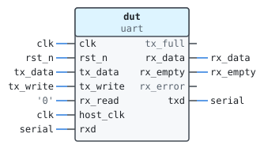
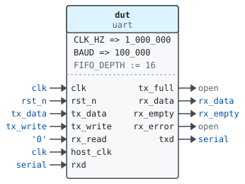
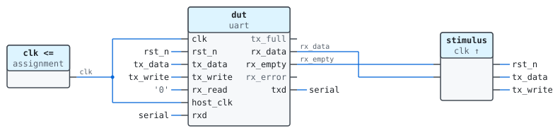

# Entity `tb_uart`

Library `work` · `tb/tb_uart.vhd:5` · testbench

Uses `ieee.std_logic_1164`.

Sends a byte through the UART looped back on itself.

## Architecture `sim`

### Instances

| Instance | Unit | Kind |
|---|---|---|
| `dut` | [`uart`](work.uart.md) | entity |

### Port maps

#### `dut`

### Data flow

### Processes

| Process | Clock | Drives | Description |
|---|---|---|---|
| `stimulus` | `clk` | `rst_n`, `tx_data`, `tx_write` | Writes one byte and waits for it to come back. |

### Signals

| Name | Type | Default | Description |
|---|---|---|---|
| `clk` | `std_logic` | `'0'` |  |
| `rst_n` | `std_logic` | `'0'` |  |
| `tx_data` | `std_logic_vector(7 downto 0)` |  |  |
| `tx_write` | `std_logic` | `'0'` |  |
| `rx_data` | `std_logic_vector(7 downto 0)` |  |  |
| `rx_empty` | `std_logic` |  |  |
| `serial` | `std_logic` |  | The loop-back wire |
