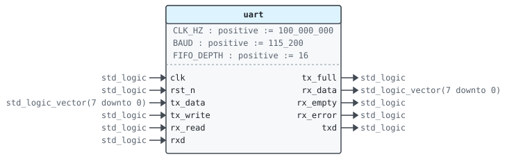
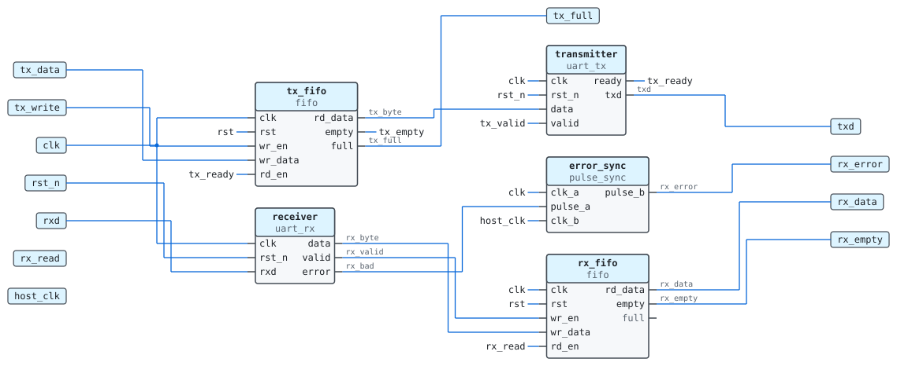
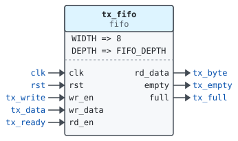
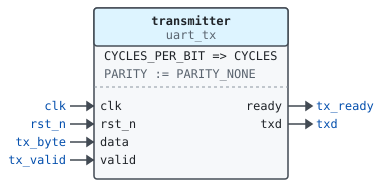
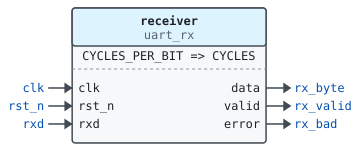
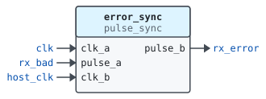
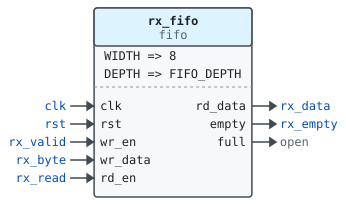
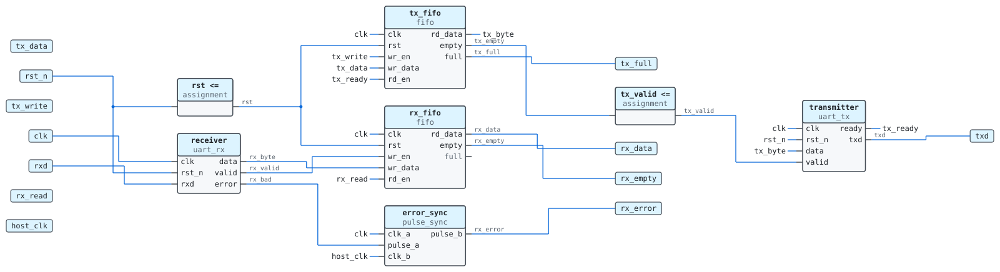

# Entity `uart`

Library `work` · `rtl/uart.vhd:10`

Uses `ieee.std_logic_1164`, [`uart_pkg`](work.uart_pkg.md).

A UART with a FIFO on each side.

Bytes written to `tx_data` are queued and sent on `txd`; bytes received
on `rxd` are queued until read from `rx_data`.

## Generics

| Name | Type | Default | Description |
|---|---|---|---|
| `CLK_HZ` | `positive` | `100_000_000` | Clock frequency |
| `BAUD` | `positive` | `115_200` | Baud rate |
| `FIFO_DEPTH` | `positive` | `16` | Words in each FIFO |

## Ports

| Name | Direction | Type | Description |
|---|---|---|---|
| `clk` | in | `std_logic` | Clock |
| `rst_n` | in | `std_logic` | Asynchronous reset, active low |
| `tx_data` | in | `std_logic_vector(7 downto 0)` | Byte to queue for sending |
| `tx_write` | in | `std_logic` | Queue `tx_data` |
| `tx_full` | out | `std_logic` | The transmit FIFO is full |
| `rx_data` | out | `std_logic_vector(7 downto 0)` | Oldest received byte |
| `rx_read` | in | `std_logic` | Take `rx_data` |
| `rx_empty` | out | `std_logic` | No received byte |
| `host_clk` | in | `std_logic` | Clock of `rx_error` |
| `rx_error` | out | `std_logic` | A frame had a bad stop bit, on `host_clk` |
| `txd` | out | `std_logic` | Serial output |
| `rxd` | in | `std_logic` | Serial input |

## Instantiated by

- [`tb_uart(sim)`](work.tb_uart.md#arch-sim) as `dut`

## Architecture `rtl`

### Instances

| Instance | Unit | Kind | Description |
|---|---|---|---|
| `tx_fifo` | [`fifo`](work.fifo.md) | entity | Bytes waiting to be sent. |
| `transmitter` | [`uart_tx`](work.uart_tx.md) | entity |  |
| `receiver` | [`uart_rx`](work.uart_rx.md) | entity |  |
| `error_sync` | [`pulse_sync`](work.pulse_sync.md) | entity | Brings the error pulses to the host clock. |
| `rx_fifo` | [`fifo`](work.fifo.md) | entity | Bytes received and not read yet. |

### Port maps

#### `tx_fifo`

#### `transmitter`

#### `receiver`

#### `error_sync`

#### `rx_fifo`

### Data flow

### Clock domains

### Signals

| Name | Type | Description |
|---|---|---|
| `rst` | `std_logic` | Synchronous reset for the FIFOs |
| `tx_byte` | `std_logic_vector(7 downto 0)` | Next byte to send |
| `tx_empty` | `std_logic` |  |
| `tx_valid` | `std_logic` |  |
| `tx_ready` | `std_logic` |  |
| `rx_byte` | `std_logic_vector(7 downto 0)` | Last received byte |
| `rx_valid` | `std_logic` |  |
| `rx_bad` | `std_logic` | A bad stop bit, on `clk` |

### Constants

| Name | Type | Value | Description |
|---|---|---|---|
| `CYCLES` | `positive` | `cycles_per_bit(CLK_HZ, BAUD)` | Clock cycles per bit |
