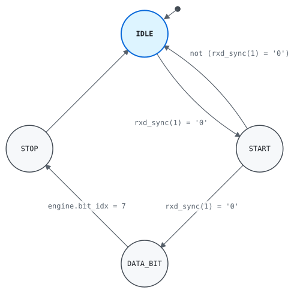

# Entity `uart_rx`

Library `work` · `rtl/uart_rx.vhd:6`

Deserializes frames of eight data bits and one stop bit, sampling each
bit in its middle.

## Generics

| Name | Type | Default | Description |
|---|---|---|---|
| `CYCLES_PER_BIT` | `positive` | `868` | Clock cycles per bit |

## Ports

| Name | Direction | Type | Description |
|---|---|---|---|
| `clk` | in | `std_logic` | Clock |
| `rst_n` | in | `std_logic` | Asynchronous reset, active low |
| `rxd` | in | `std_logic` | Serial input |
| `data` | out | `std_logic_vector(7 downto 0)` | Received byte |
| `valid` | out | `std_logic` | `data` holds a new byte, for one cycle |
| `error` | out | `std_logic` | The stop bit was low |

## Instantiated by

- [`uart(rtl)`](work.uart.md#arch-rtl) as `receiver`

## Architecture `rtl`

### Processes

| Process | Sensitivity | Clock | Drives | Description |
|---|---|---|---|---|
| `regs` | `clk`, `rst_n` | `clk` | `engine`, `rxd_sync` | Registers, with an asynchronous reset. |
| `comb` | `all` |  | `engine_next`, `valid`, `error` | Next-state logic. |

### State machine `engine.state`

Type `state_t` · next state `engine_next.state` · process `comb` · initial state `IDLE`

Current and next registers

| From | To | Condition |
|---|---|---|
| `IDLE` | `START` | `rxd_sync(1) = '0'` |
| `START` | `DATA_BIT` | `rxd_sync(1) = '0'` |
| `START` | `IDLE` | `not (rxd_sync(1) = '0')` |
| `DATA_BIT` | `STOP` | `engine.bit_idx = 7` |
| `STOP` | `IDLE` |  |

### Signals

| Name | Type | Description |
|---|---|---|
| `engine` | `engine_t` | Current and next registers |
| `engine_next` | `engine_t` | Current and next registers |
| `rxd_sync` | `std_logic_vector(1 downto 0)` | Synchronizer |

### Types

| Name | Kind | Definition | Description |
|---|---|---|---|
| `state_t` | type | `(IDLE, START, DATA_BIT, STOP)` |  |
| `engine_t` | type | `record state : state_t; shift : std_logic_vector(7 downto 0); bit_idx : natural range 0 to 7; timer : natural range 0 to CYCLES_PER_BIT - 1; end record` | The receiver's registers. |
