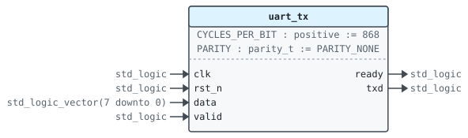
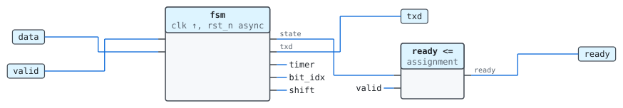
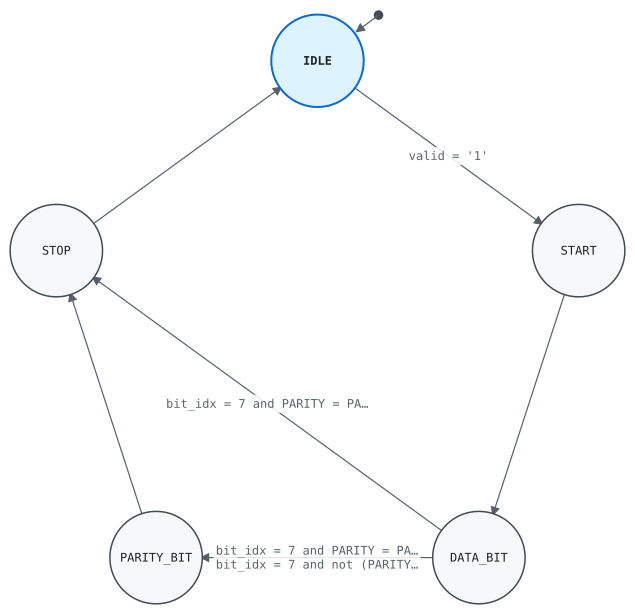

# Entity `uart_tx`

Library `work` · `rtl/uart_tx.vhd:24`

Uses `ieee.std_logic_1164`, [`uart_pkg`](work.uart_pkg.md).

Serializes bytes: a start bit, the data bits LSB first, an optional
parity bit and a stop bit.

## Generics

| Name | Type | Default | Description |
|---|---|---|---|
| `CYCLES_PER_BIT` | `positive` | `868` | Clock cycles per bit |
| `PARITY` | `parity_t` | `PARITY_NONE` | Parity bit |

## Ports

| Name | Direction | Type | Description |
|---|---|---|---|
| `clk` | in | `std_logic` | Clock |
| `rst_n` | in | `std_logic` | Asynchronous reset, active low |
| `data` | in | `std_logic_vector(7 downto 0)` | Byte to send |
| `valid` | in | `std_logic` | `data` holds a byte to send |
| `ready` | out | `std_logic` | A byte is taken this cycle |
| `txd` | out | `std_logic` | Serial output |

## Instantiated by

- [`uart(rtl)`](work.uart.md#arch-rtl) as `transmitter`

## Architecture `rtl`

### Data flow

### Processes

| Process | Sensitivity | Clock | Drives | Description |
|---|---|---|---|---|
| `fsm` | `clk`, `rst_n` | `clk` | `state`, `txd`, `timer`, `bit_idx`, `shift` | Steps through the frame, one bit every `CYCLES_PER_BIT` cycles. |

### State machine `state`

Type `state_t` · process `fsm` · initial state `IDLE`

Transmitter state

| From | To | Condition |
|---|---|---|
| `IDLE` | `START` | `valid = '1'` |
| `START` | `DATA_BIT` |  |
| `DATA_BIT` | `STOP` | `bit_idx = 7 and PARITY = PARITY_NONE` |
| `DATA_BIT` | `PARITY_BIT` | `bit_idx = 7 and PARITY = PARITY_EVEN` |
| `DATA_BIT` | `PARITY_BIT` | `bit_idx = 7 and not (PARITY = PARITY_NONE or PARITY = PARITY_EVEN)` |
| `PARITY_BIT` | `STOP` |  |
| `STOP` | `IDLE` |  |

### Signals

| Name | Type | Description |
|---|---|---|
| `state` | `state_t` | Transmitter state |
| `shift` | `std_logic_vector(7 downto 0)` | Bits left to send |
| `bit_idx` | `natural range 0 to 7` | Data bit being sent |
| `timer` | `natural range 0 to CYCLES_PER_BIT - 1` |  |

### Types

| Name | Kind | Definition |
|---|---|---|
| `state_t` | type | `(IDLE, START, DATA_BIT, PARITY_BIT, STOP)` |
