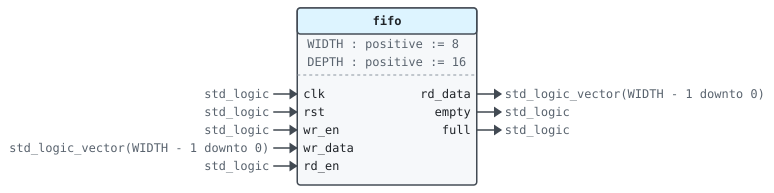

# Entity `fifo`

Library `work` · `rtl/fifo.vhd:8` · architecture `rtl`

## 1 Overview

A synchronous first-in first-out buffer.

Writes to a full FIFO and reads from an empty one are ignored.

## 2 Interface

### 2.1 Generics

| Name | Type | Default | Description |
|---|---|---|---|
| `WIDTH` | `positive` | `8` | Bits per word |
| `DEPTH` | `positive` | `16` | Number of words |

### 2.2 Ports

| Name | Direction | Size | Description |
|---|---|---|---|
| `clk` | in | 1 | Clock |
| `rst` | in | 1 | Synchronous reset, active high |
| `wr_en` | in | 1 | Write `wr_data` this cycle |
| `wr_data` | in | `WIDTH` (default 8) | Word to write |
| `rd_en` | in | 1 | Take the oldest word |
| `rd_data` | out | `WIDTH` (default 8) | Oldest word |
| `empty` | out | 1 | No word to read |
| `full` | out | 1 | No room to write |

## 3 Clocks and resets

| Clock | Edge | Used by |
|---|---|---|
| `clk` | rising | `pointers` |

| Reset | Kind | Clock | Used by |
|---|---|---|---|
| `rst` | synchronous, active high | `clk` | `pointers` |

## 4 Behavior

### 4.1 Architecture `rtl`

| Process | Kind | Drives | Description |
|---|---|---|---|
| `pointers` | clocked on `clk`, synchronous reset `rst` | `head`, `tail`, `count`, `memory` | Moves the pointers and stores written words. |

## 5 Registers

| Register | Type | Clock | Reset | Process | Description |
|---|---|---|---|---|---|
| `head` | `natural range 0 to DEPTH - 1` | `clk` | `rst` (synchronous, active high) | `pointers` | Next word to write |
| `tail` | `natural range 0 to DEPTH - 1` | `clk` | `rst` (synchronous, active high) | `pointers` | Next word to read |
| `count` | `natural range 0 to DEPTH` | `clk` | `rst` (synchronous, active high) | `pointers` | Words stored |
| `memory` | `memory_t` | `clk` | `rst` (synchronous, active high) | `pointers` |  |
