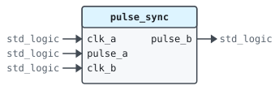

# Entity `pulse_sync`

Library `work` · `rtl/pulse_sync.vhd:8` · architecture `rtl`

## 1 Overview

Carries single-cycle pulses from one clock domain to another.

Each source pulse flips a toggle; the destination domain synchronizes the
toggle through two flip-flops and pulses when it changes.

## 2 Interface

### 2.1 Ports

| Name | Direction | Type | Timing | Description |
|---|---|---|---|---|
| `clk_a` | in | `std_logic` | clock | Source clock |
| `pulse_a` | in | `std_logic` | sampled on `clk_a` | Pulse in the source domain |
| `clk_b` | in | `std_logic` | clock | Destination clock |
| `pulse_b` | out | `std_logic` | combinational | Pulse in the destination domain |

## 3 Clocks and resets

| Clock | Edge | Used by |
|---|---|---|
| `clk_a` | rising | `source` |
| `clk_b` | rising | `destination` |

| Crossing | From | To | Read by |
|---|---|---|---|
| `toggle` | `clk_a` | `clk_b` | `destination` |

## 4 Behavior

### 4.1 Architecture `rtl`

| Process | Kind | Drives | Description |
|---|---|---|---|
| `source` | clocked on `clk_a` | `toggle` | Flips the toggle on each source pulse. |
| `destination` | clocked on `clk_b` | `sync` | Samples the toggle in the destination domain. |

## 5 Registers

| Register | Type | Clock | Process | Description |
|---|---|---|---|---|
| `toggle` | `std_logic` | `clk_a` | `source` | Flips on each source pulse |
| `sync` | `std_logic_vector(2 downto 0)` | `clk_b` | `destination` | Synchronizer and edge detector |
