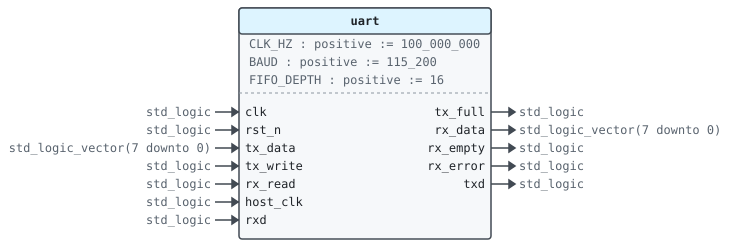
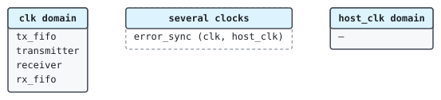

# Entity `uart`

Library `work` · `rtl/uart.vhd:17` · architecture `rtl`

## 1 Overview

A UART with a FIFO on each side.

Bytes written to `tx_data` are queued and sent on `txd`; bytes received
on `rxd` are queued until read from `rx_data`.

The bit rate is `CLK_HZ / BAUD`, rounded to the nearest whole number
of clock cycles per bit.

- `UART-1` Sends the bytes written to `tx_data` on `txd` in the order they were written, and receives the bytes of `rxd` in the order they came.
- `UART-2` Holds up to `FIFO_DEPTH` bytes each way: `tx_full` and `rx_empty` say when a side can take or give no byte.

## 2 Interface

### 2.1 Generics

| Name | Type | Default | Description |
|---|---|---|---|
| `CLK_HZ` | `positive` | `100_000_000` | Clock frequency |
| `BAUD` | `positive` | `115_200` | Baud rate |
| `FIFO_DEPTH` | `positive` | `16` | Words in each FIFO |

### 2.2 Ports

| Name | Direction | Type | Timing | Description | Specification |
|---|---|---|---|---|---|
| `clk` | in | `std_logic` | clock | Clock |  |
| `rst_n` | in | `std_logic` | reset (asynchronous, active low) | Asynchronous reset, active low |  |
| `tx_data` | in | `std_logic_vector(7 downto 0)` | sampled on `clk` | Byte to queue for sending |  |
| `tx_write` | in | `std_logic` | sampled on `clk` | Queue `tx_data` |  |
| `tx_full` | out | `std_logic` | combinational | The transmit FIFO is full |  |
| `rx_data` | out | `std_logic_vector(7 downto 0)` | combinational | Oldest received byte |  |
| `rx_read` | in | `std_logic` | sampled on `clk` | Take `rx_data` |  |
| `rx_empty` | out | `std_logic` | combinational | No received byte |  |
| `host_clk` | in | `std_logic` | clock | Clock of `rx_error` |  |
| `rx_error` | out | `std_logic` | combinational | A frame had a bad stop bit, on `host_clk` | `UART-3` |
| `txd` | out | `std_logic` | registered on `clk` | Serial output |  |
| `rxd` | in | `std_logic` | sampled on `clk` | Serial input |  |

## 3 Clocks and resets

| Clock | Edge | Used by |
|---|---|---|
| `clk` | rising | `tx_fifo`, `transmitter`, `receiver`, `error_sync`, `rx_fifo` |
| `host_clk` | rising | `error_sync` |

| Reset | Kind | Used by |
|---|---|---|
| `rst_n` | asynchronous, active low | `transmitter`, `receiver` |

## 4 Behavior

### 4.1 Architecture `rtl`

## 5 Sub-blocks

| Instance | Unit | Description | Specification |
|---|---|---|---|
| `tx_fifo` | [`fifo`](work.fifo.md) | Bytes waiting to be sent. |  |
| `transmitter` | [`uart_tx`](work.uart_tx.md) |  |  |
| `receiver` | [`uart_rx`](work.uart_rx.md) |  |  |
| `error_sync` | [`pulse_sync`](work.pulse_sync.md) | Brings the error pulses to the host clock. | `rx_bad` is the only signal crossing from `clk` to `host_clk`. |
| `rx_fifo` | [`fifo`](work.fifo.md) | Bytes received and not read yet. |  |

## 6 Requirements

| ID | Requirement | Applies to | Source | Verified by |
|---|---|---|---|---|
| `UART-1` | Sends the bytes written to `tx_data` on `txd` in the order they were written, and receives the bytes of `rxd` in the order they came. | entity | `rtl/uart.vhd:11` | `tb_uart.stimulus` `tb/tb_uart.vhd:40` |
| `UART-2` | Holds up to `FIFO_DEPTH` bytes each way: `tx_full` and `rx_empty` say when a side can take or give no byte. | entity | `rtl/uart.vhd:13` |  |
| `UART-3` | A frame with a bad stop bit gives one pulse of `rx_error`, one `host_clk` cycle long. | port `rx_error` | `rtl/uart.vhd:35` |  |
