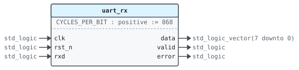
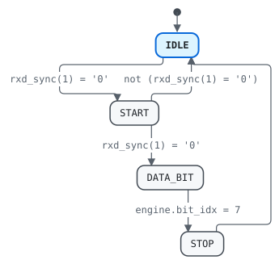

# Entity `uart_rx`

Library `work` · `rtl/uart_rx.vhd:11` · architecture `rtl`

## 1 Overview

Deserializes frames of eight data bits and one stop bit, sampling each
bit in its middle.

- `RX-1` Samples each bit `CYCLES_PER_BIT / 2` cycles after its start, and ignores a start bit that is high again by then.
- `RX-2` Gives each byte on `data` with `valid` high for one cycle, or `error` high for one cycle when the stop bit is low.

## 2 Interface

### 2.1 Generics

| Name | Type | Default | Description |
|---|---|---|---|
| `CYCLES_PER_BIT` | `positive` | `868` | Clock cycles per bit |

### 2.2 Ports

| Name | Direction | Type | Timing | Description |
|---|---|---|---|---|
| `clk` | in | `std_logic` | clock | Clock |
| `rst_n` | in | `std_logic` | reset (asynchronous, active low) | Asynchronous reset, active low |
| `rxd` | in | `std_logic` | sampled on `clk` | Serial input |
| `data` | out | `std_logic_vector(7 downto 0)` | combinational | Received byte |
| `valid` | out | `std_logic` | combinational | `data` holds a new byte, for one cycle |
| `error` | out | `std_logic` | combinational | The stop bit was low |

## 3 Clocks and resets

| Clock | Edge | Used by |
|---|---|---|
| `clk` | rising | `regs` |

| Reset | Kind | Clock | Used by |
|---|---|---|---|
| `rst_n` | asynchronous, active low | `clk` | `regs` |

## 4 Behavior

### 4.1 Architecture `rtl`

| Process | Kind | Drives | Description |
|---|---|---|---|
| `regs` | clocked on `clk`, asynchronous reset `rst_n` | `engine`, `rxd_sync` | Registers, with an asynchronous reset. |
| `comb` | combinational | `engine_next`, `valid`, `error` | Next-state logic. |

## 5 State machines

### 5.1 State machine `engine.state`

Type `state_t` · process `comb` · initial state `IDLE`

Current and next registers

States: `IDLE`, `START`, `DATA_BIT`, `STOP`

| From | To | Condition |
|---|---|---|
| `IDLE` | `START` | `rxd_sync(1) = '0'` |
| `START` | `DATA_BIT` | `rxd_sync(1) = '0'` |
| `START` | `IDLE` | `not (rxd_sync(1) = '0')` |
| `DATA_BIT` | `STOP` | `engine.bit_idx = 7` |
| `STOP` | `IDLE` |  |

## 6 Registers

| Register | Type | Clock | Reset | Process | Description | Specification |
|---|---|---|---|---|---|---|
| `engine` | `engine_t` | `clk` | `rst_n` (asynchronous, active low) | `regs` | Current and next registers |  |
| `rxd_sync` | `std_logic_vector(1 downto 0)` | `clk` | `rst_n` (asynchronous, active low) | `regs` | Synchronizer | `rxd` goes through two registers before it is read, as it is not synchronous to `clk`. |

## 7 Requirements

| ID | Requirement | Applies to | Source | Verified by |
|---|---|---|---|---|
| `RX-1` | Samples each bit `CYCLES_PER_BIT / 2` cycles after its start, and ignores a start bit that is high again by then. | entity | `rtl/uart_rx.vhd:7` |  |
| `RX-2` | Gives each byte on `data` with `valid` high for one cycle, or `error` high for one cycle when the stop bit is low. | entity | `rtl/uart_rx.vhd:9` | `tb_uart.stimulus` `tb/tb_uart.vhd:40` |
