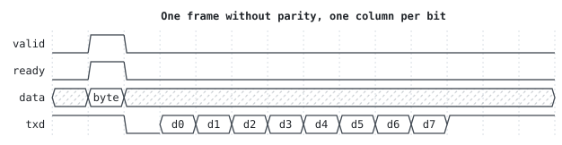
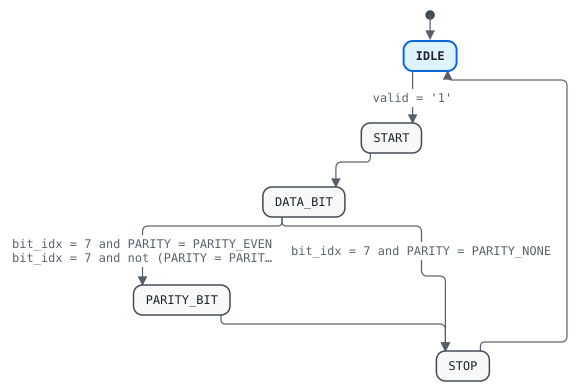

# Entity `uart_tx`

Library `work` · `rtl/uart_tx.vhd:24` · architecture `rtl`

## 1 Overview

Serializes bytes: a start bit, the data bits LSB first, an optional
parity bit and a stop bit.

- `TX-1` Idles high, then sends a frame per byte: a start bit (low), the eight data bits LSB first, a parity bit unless `PARITY` is `PARITY_NONE`, and a stop bit (high).
- `TX-2` Each bit lasts `CYCLES_PER_BIT` clock cycles.

## 2 Interface

### 2.1 Generics

| Name | Type | Default | Description |
|---|---|---|---|
| `CYCLES_PER_BIT` | `positive` | `868` | Clock cycles per bit |
| `PARITY` | `parity_t` | `PARITY_NONE` | Parity bit |

### 2.2 Ports

| Name | Direction | Type | Timing | Description | Specification |
|---|---|---|---|---|---|
| `clk` | in | `std_logic` | clock | Clock |  |
| `rst_n` | in | `std_logic` | reset (asynchronous, active low) | Asynchronous reset, active low |  |
| `data` | in | `std_logic_vector(7 downto 0)` | sampled on `clk` | Byte to send |  |
| `valid` | in | `std_logic` | sampled on `clk` | `data` holds a byte to send |  |
| `ready` | out | `std_logic` | combinational | A byte is taken this cycle | `TX-3` |
| `txd` | out | `std_logic` | registered on `clk` | Serial output |  |

## 3 Clocks and resets

| Clock | Edge | Used by |
|---|---|---|
| `clk` | rising | `fsm` |

| Reset | Kind | Clock | Used by |
|---|---|---|---|
| `rst_n` | asynchronous, active low | `clk` | `fsm` |

## 4 Behavior

### 4.1 Architecture `rtl`

| Process | Kind | Drives | Description |
|---|---|---|---|
| `fsm` | clocked on `clk`, asynchronous reset `rst_n` | `state`, `txd`, `timer`, `bit_idx`, `shift` | Steps through the frame, one bit every `CYCLES_PER_BIT` cycles. |

## 5 State machines

### 5.1 State machine `state`

Type `state_t` · process `fsm` · initial state `IDLE`

Transmitter state

States: `IDLE`, `START`, `DATA_BIT`, `PARITY_BIT`, `STOP`

| From | To | Condition |
|---|---|---|
| `IDLE` | `START` | `valid = '1'` |
| `START` | `DATA_BIT` |  |
| `DATA_BIT` | `STOP` | `bit_idx = 7 and PARITY = PARITY_NONE` |
| `DATA_BIT` | `PARITY_BIT` | `bit_idx = 7 and PARITY = PARITY_EVEN` |
| `DATA_BIT` | `PARITY_BIT` | `bit_idx = 7 and not (PARITY = PARITY_NONE or PARITY = PARITY_EVEN)` |
| `PARITY_BIT` | `STOP` |  |
| `STOP` | `IDLE` |  |

## 6 Registers

| Register | Type | Clock | Reset | Process | Description |
|---|---|---|---|---|---|
| `state` | `state_t` | `clk` | `rst_n` (asynchronous, active low) | `fsm` | Transmitter state |
| `txd` | `std_logic` | `clk` | `rst_n` (asynchronous, active low) | `fsm` | Serial output |
| `timer` | `natural range 0 to CYCLES_PER_BIT - 1` | `clk` | `rst_n` (asynchronous, active low) | `fsm` |  |
| `bit_idx` | `natural range 0 to 7` | `clk` | `rst_n` (asynchronous, active low) | `fsm` | Data bit being sent |
| `shift` | `std_logic_vector(7 downto 0)` | `clk` | `rst_n` (asynchronous, active low) | `fsm` | Bits left to send |

## 7 Requirements

| ID | Requirement | Applies to | Source | Verified by |
|---|---|---|---|---|
| `TX-1` | Idles high, then sends a frame per byte: a start bit (low), the eight data bits LSB first, a parity bit unless `PARITY` is `PARITY_NONE`, and a stop bit (high). | entity | `rtl/uart_tx.vhd:20` | `tb_uart.stimulus` `tb/tb_uart.vhd:40` |
| `TX-2` | Each bit lasts `CYCLES_PER_BIT` clock cycles. | entity | `rtl/uart_tx.vhd:23` |  |
| `TX-3` | `ready` is high in the cycle `data` is taken, only while no frame is being sent. | port `ready` | `rtl/uart_tx.vhd:34` |  |
